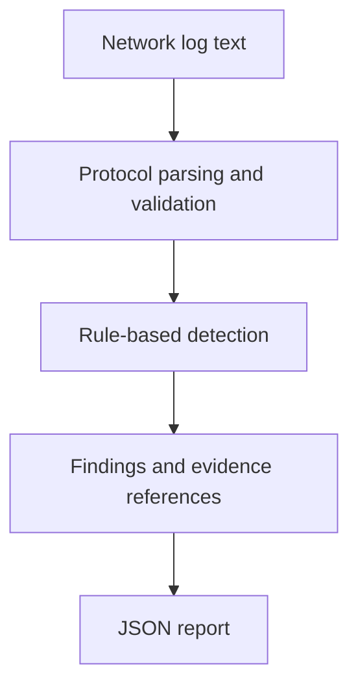

# Network Security Traffic Analyzer

[](https://colab.research.google.com/github/GitMasterMindX/Network_Security_Traffic_Analyzer/blob/main/Network_Security_Traffic_Analyzer_Public_Demo.ipynb)

Evidence-driven Python network-log analysis with source-line provenance, rule-based detection and structured JSON reporting. All public inputs are synthetic. Educational prototype, not a production IDS.

## Quick start — Google Colab

1. Click **Open in Colab** above (Google sign-in may be required).
2. Review the code, then select **Runtime → Run all** and approve the external notebook warning if you trust the code.
3. Review the final results and optionally download the JSON report.

No ZIP upload or local Python installation is required. Internet access is required.

## Architecture



## Detection capabilities

| Scenario | Public demo findings |
|---|---|
| DNS / ICMP | Query and port-unreachable pattern |
| HTTP | GET and DNS answers |
| TCP | Suspicious SYN burst, ACK counterexample, HTTP 504 |

## Reproducibility in Google Colab

Use the badge above, then **Runtime > Run all**. The setup clones the public repository and checks out the pinned analyzer baseline `28829fc98de74a22a70ac8371256f460d5788bf6`. No ZIP upload is needed. Review notebook code before executing it. Internet access is required.

## Run locally

Clone the repository, enter its directory, and run:

```bash
python -m pip install pytest==9.2.0
python run_demo.py
python -m pytest -q
```

Alternatively open `Network_Security_Traffic_Analyzer_Public_Demo.ipynb` in local Jupyter and run all cells. The analyzer itself uses only the Python standard library.

## Validation

- Windows, Python 3.12.10: 6 public tests passed.
- Google Colab: 6 public tests passed; automatic setup and JSON generation verified before the recruiter UX update.
- Public demo: DNS/ICMP, HTTP and TCP scenarios; JSON report at `reports/synthetic_demo_report.json`.
- Private course evidence is excluded from this repository.

## Limitations

- Limited tcpdump/Wireshark text formats; no raw PCAP reader.
- Findings are observed or suspicious; SYN bursts do not prove intent or resource exhaustion.
- DNS/ICMP co-occurrence does not prove packet-level causality.
- The ACK counterexample rule uses a fixed educational IP address, not general-purpose connection correlation.
- Synthetic data is not evidence of a real incident.

## Repository layout

- `analyzer_v04.py`: parsing and detection
- `run_demo.py`: command-line demo
- `synthetic_data/`: public input fixtures
- `tests/`: regression tests
- `reports/`: example structured report
- `Network_Security_Traffic_Analyzer_Public_Demo.ipynb`: interactive demo
